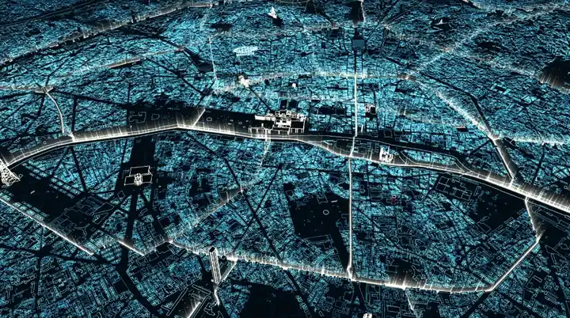
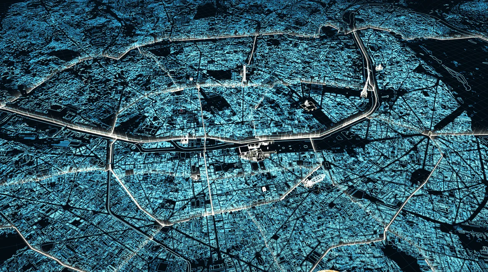
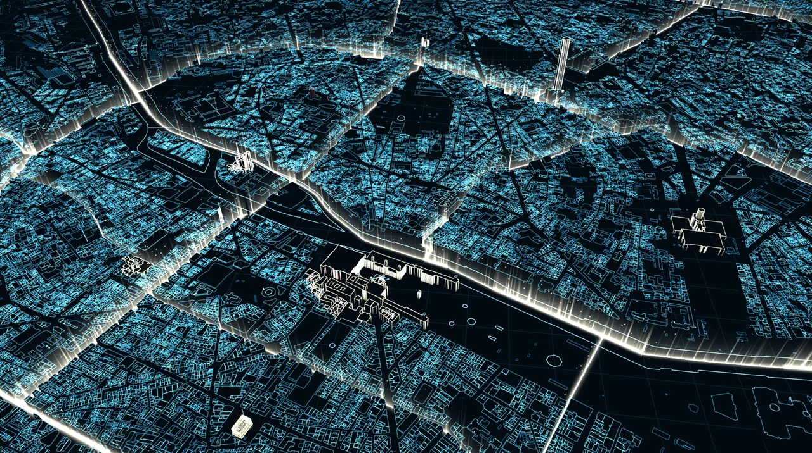
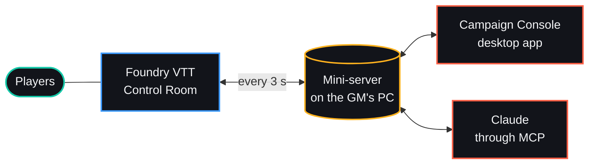

<p align="center">
  
</p>

<p align="center">
  
  
  
  
  
</p>

<p align="center">
  <b>English</b> · <a href="README.fr.md">Français</a>
</p>

<p align="center">
  
</p>

**Turn the real Paris into your campaign board.** Control Room is a Foundry VTT module for a World of Darkness
chronicle set in Paris. It opens a holographic 3D map of the city, with every building, the relief, the Seine and the
20 arrondissements, and a live panel of the factions' units. Drag a unit onto a place and your players see it move.

The same data can be read and changed from outside Foundry: by the [Campaign Console](https://github.com/Nave20/campaign-console)
desktop app, or by Claude through MCP. A change on one side shows on the other.

> [!NOTE]
> **This module needs a small server running on the GM's computer**, provided by
> [Campaign Console](https://github.com/Nave20/campaign-console). Without it, the module stays locked: it shows a
> warning and changes nothing. The interface is in French for now.

<table>
  <tr>
    <td width="50%"></td>
    <td width="50%"></td>
  </tr>
  <tr>
    <td align="center"><sub>The whole city, every building</sub></td>
    <td align="center"><sub>Zoom in on any block</sub></td>
  </tr>
</table>

## Features

- **Holographic Paris in 3D.** Real buildings, relief and landmarks from IGN open data, in a slowly turning
  hologram you can pause, zoom and explore.
- **Live units panel.** Name, strength and status of every unit. The GM edits, players watch in read-only mode.
- **Drag-and-drop deployment.** Drop a unit card on a place of the map to send it there, with an optional mission.
  Military-style symbols show who stands where.
- **Places and secrets.** Each place of your campaign lights up the nearest real building in its faction's colour.
  Players only ever receive the places that were revealed to them.
- **Territories.** Tint each arrondissement by the faction that holds it, in a simple or detailed mode, with
  hatching for contested ground.
- **Pings.** Alt + click raises a column of light that every player sees for ten seconds. The GM can centre
  everyone's view on it.

## How it works



The mini-server is the single source of truth: it keeps units, the map and the campaign in one file on the GM's
computer. In Foundry, only the active GM talks to it and passes the changes on to the players.

## Quick start

1. Install and start [Campaign Console](https://github.com/Nave20/campaign-console) (or its `start-server.cmd`).
   The server listens on `http://127.0.0.1:30010`, on the GM's computer only.
2. Clone this module into your Foundry data folder:

   ```bash
   git clone https://github.com/Nave20/foundry-wod-control-room "<Foundry data>/modules/wod-control-room"
   ```

3. Enable **Control Room** in your world. If you changed the server port, set it in the module settings.
4. Open the **Salle de contrôle** group on the left toolbar: the first tool opens the hologram, the second the units.

<details>
<summary><b>Full feature guide</b></summary>

### Deploying units

- **Drag and drop (GM):** drag a unit card from the panel onto a revealed place of the hologram, or onto a line of the
  places list. The unit becomes *engaged*. Units that are absent, wounded, lost or empty can't be deployed.
- **Map symbols:** above each occupied place, one symbol per group with its number of units (solid: deployed;
  dotted: at home). Hover for the list of units and a *Recall* button; click to open the group in the panel.
- **Right-click a unit card (GM):** recall it, set its home place, or change its badge.

### Places

The server keeps the campaign map: places, factions, arrondissements and quarters. Each place lights the nearest real
building (or a ground beacon if none stands within 40 m). Click a label to open the place; the **Lieux** button opens a
searchable, filterable list. The GM also sees unrevealed places, in dotted lines.

### Territories

The **Territoires** button tints each arrondissement by its faction. Click again to switch from the simple mode (one
colour per kind of creature) to the detailed mode (one colour per faction), then off. An arrondissement belongs to the
faction set on it, otherwise to the majority faction of its quarters; a tie or a contested quarter makes it contested.
Players get the same rule applied to revealed areas only.

### Pings

In the hologram, **Alt + click** (or the **Ping** button, then a click) raises a column of light with the player's name
in their colour, visible to everyone for ten seconds. **Alt + Shift + click** (GM) also centres everyone's view on it.
Pings go through Foundry's socket, so they work even when the server is off.

</details>

## Development

```bash
# tests: Lambert-93 conversion, territories, deployment
node --test tests/*.test.mjs

# rebuild the 3D map from the IGN GeoPackage for Paris (dept. 75)
python tools/extract_paris.py <paris.gpkg> data/paris.bin

# regenerate the README banner
node tools/readme-banner.mjs
```

## Credits

Map data: **IGN BD TOPO**, [Licence Ouverte 2.0](https://www.etalab.gouv.fr/licence-ouverte-open-licence/) (Etalab).
3D rendering with [Three.js](https://threejs.org). A fan-made tool, not affiliated with the publishers of World of Darkness.

<p align="center"><sub>Made by <a href="https://github.com/Nave20">Nave20</a>, Game Master and student at 42 Lyon.</sub></p>
